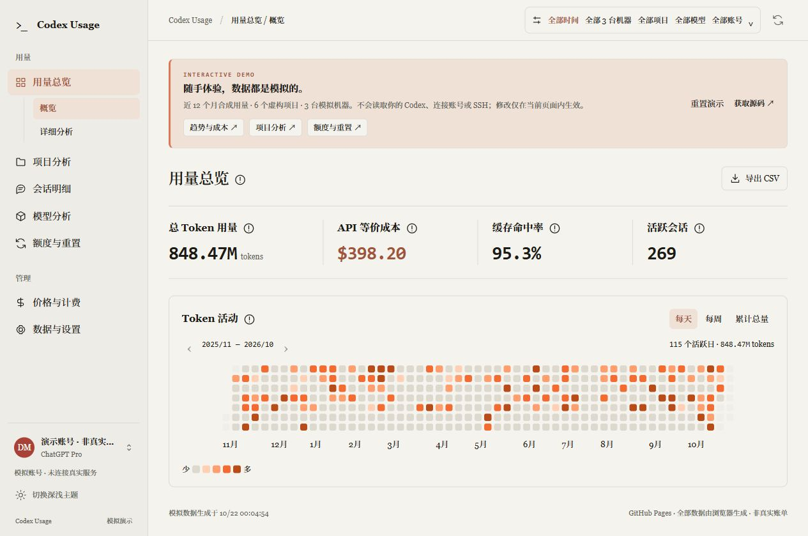
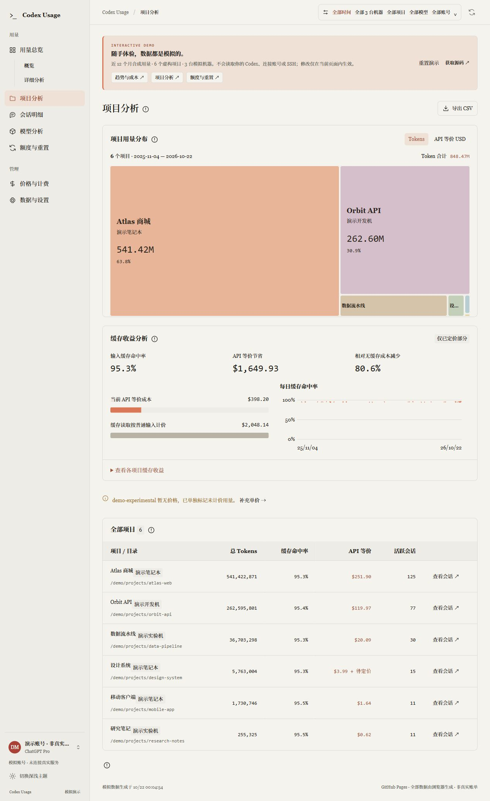
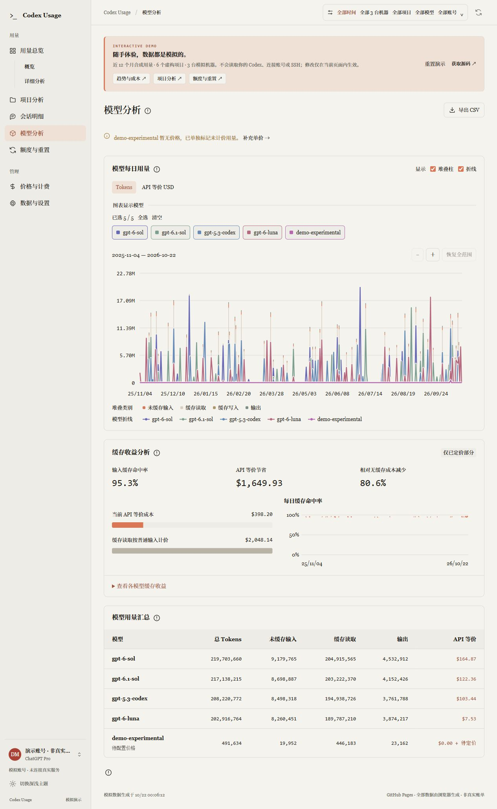
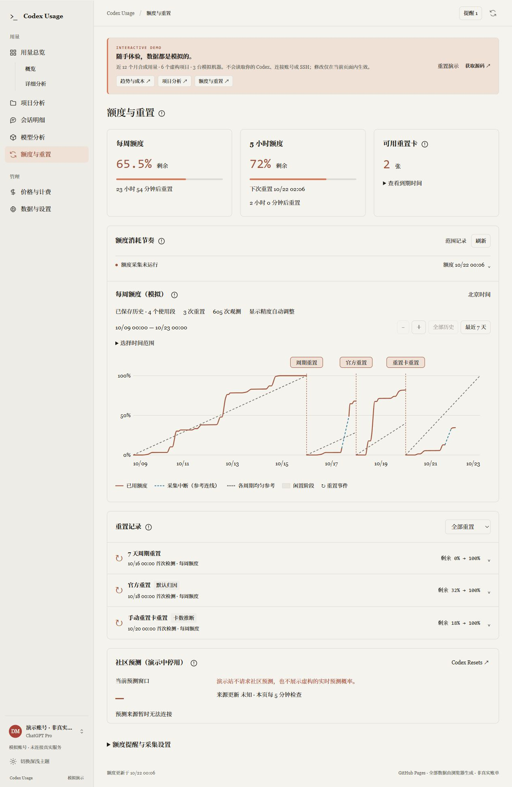

# Codex Usage

[](https://github.com/KJesko/codex-usage/actions/workflows/ci.yml)
[](LICENSE)

一个中文、优先在本地运行的 **Codex 用量看板**。按日期、项目、会话和模型查看 Token 消耗，估算 API 等价成本，记录账号额度变化，也可以通过 SSH 汇总远程机器的用量。

Python 后端 + 原生 JavaScript 前端，无需前端构建。支持浏览器运行，并提供 Windows 桌面版构建脚本。

> 本项目是独立社区工具，与 OpenAI 无隶属关系。统计来自可读取的本地或远程日志；API 等价成本是估算值，不代表订阅账单、实际付款或账号的固定 Token 配额。

## 在线体验与界面预览

**[打开在线交互演示 →](https://kjesko.github.io/codex-usage/)** · 无需安装或登录。

演示站复用真实应用的前端，在浏览器中生成 **近 12 个月、6 个虚构项目、3 台模拟机器**的用量。可以切换日期、机器和模型，展开项目 / 会话详情，查看成本与缓存收益，体验额度曲线并导出模拟 CSV。

模拟场景包含稀疏工作日、周末与休假空档，项目用量从几十万到数亿 Token，输入缓存命中率约 95%。总览、活动热图、项目 / 模型 / 会话明细及 CSV 都由同一批记录汇总。默认「全部时间」的数据均在热图的 12 个日历月窗口内，合计一致。

额度曲线另行模拟夜间休息、午休、集中消耗、缓慢使用和采集中断。正常周期完整持续 7 天，均匀参考线在周期末到达 100%；提前发生的官方重置与重置卡事件单独分段。示例完整周期恰好耗尽额度，但正常周期重置并不要求实际用量达到 100%。额度百分比用于演示账号窗口，不按 Token 总数换算。

建议依次体验：[全年活动总览](https://kjesko.github.io/codex-usage/) → [近 30 天详细分析](https://kjesko.github.io/codex-usage/?view=overview&tab=analysis&range=30) → [项目分析](https://kjesko.github.io/codex-usage/?view=projects&range=all) → [额度与重置](https://kjesko.github.io/codex-usage/?view=quota)。

所有账号、用量、费用、额度及下方截图均为**模拟数据**。演示站不会读取访客的 Codex 文件、连接真实账号或 SSH，也不启动后台任务。价格与统计设置仅在当前页面内生效，刷新或点击「重置演示」即可恢复；主题偏好保存在浏览器中。导出的文件名称和内容均带有演示标记。

**用量总览：** 汇总 Token、API 等价成本、缓存命中率和会话数量，按全年活动热图查看使用节奏。

[](https://kjesko.github.io/codex-usage/)

<details>
<summary>更多截图：项目分析、模型对比、额度与重置</summary>

**项目分析：** 用矩形树图比较项目占比，点击项目查看每日趋势和所属会话。



**模型分析：** 对比模型的每日用量，切换 Token / 成本视图，查看未定价模型和缓存收益。



**额度与重置：** 默认展开完整历史，查看完整七天周期、夜间平台、蓝色采集缺口和三种重置事件，支持缩放及日期范围选择。



</details>

## 功能

| 功能 | 说明 |
| --- | --- |
| 用量总览 | 日 / 周 / 月聚合、Token 活动热图、趋势图、周期对比及增长归因 |
| 项目与会话 | 项目排行与矩形树图、项目每日趋势、会话搜索、排序和分页 |
| 模型分析 | 输入、缓存读取、缓存写入、输出及推理明细，模型趋势与缓存收益分析 |
| 成本估算 | 随仓库提供模型价格快照，支持自定义价格，未知模型明确标记为待定价 |
| 账号额度 | 通过本机 Codex 读取额度窗口、剩余比例和重置时间，保存观测历史及提醒 |
| 多机器汇总 | 合并多个 Codex 数据目录，SSH 增量同步，断线时保留上次快照 |
| 筛选与导出 | 日期、机器、项目、模型及账号分组筛选，导出适用于 Excel 的 UTF-8 CSV |
| 本地体验 | 中文界面、深浅主题、窄窗口适配、键盘操作，图表支持缩放和平移 |

## 快速开始

### 环境要求

- **Python 3.10+**；Windows 建议使用 Python 3.12。
- 本机存在 Codex 会话日志，默认目录为 `~/.codex`，也可指定其他目录。
- 首次安装 Python 依赖需要网络；安装后，本地日志统计可以离线使用。
- 账号额度功能另外需要本机可用且已登录的 Codex CLI，以及网络连接。额度读取不可用时，仍可查看日志统计。
- Node.js 仅用于前端开发检查或可选的 `npm start` 启动方式，日常运行不需要。

### Windows

```powershell
git clone https://github.com/KJesko/codex-usage.git
cd codex-usage
powershell -NoProfile -ExecutionPolicy Bypass -File .\run.ps1
```

也可以在下载并解压源码后双击 `run.bat`。启动脚本会创建项目内的 `.venv` 并安装所需时区数据，随后自动打开 <http://127.0.0.1:8787>。

### macOS / Linux

```sh
git clone https://github.com/KJesko/codex-usage.git
cd codex-usage
python3 -m venv .venv
.venv/bin/python -m pip install -r requirements.txt
.venv/bin/python codex_usage.py
```

### 安装为命令行程序

在已激活的 Python 虚拟环境中，从仓库根目录执行：

```sh
python -m pip install .
codex-usage
```

这里使用源码安装；无需从 npm 或 PyPI 安装同名包。当前仓库不包含预构建的 Windows exe。

## 使用与配置

进入「数据与设置」可以修改统计时区、统计起始日期、数据目录、模型价格和提醒设置。默认统计时区为 `America/Los_Angeles`；需要北京时间时可改为 `Asia/Shanghai`。

浏览器版常用参数：

| 参数 | 用途 |
| --- | --- |
| `--port 8790` | 更换端口，默认 `8787` |
| `--no-browser` | 启动服务但不自动打开浏览器 |
| `--codex-home PATH` | 指定 Codex 日志目录，可重复传入以合并多个目录 |
| `--data-dir PATH` | 指定本工具的配置与缓存目录，默认 `~/.codex-usage` |
| `--timezone Asia/Shanghai` | 指定 IANA 统计时区 |
| `--version` | 显示版本 |

例如，在 Windows 上合并两个日志目录：

```powershell
.\run.ps1 --timezone Asia/Shanghai --codex-home "$env:USERPROFILE\.codex" --codex-home "D:\codex-logs" --port 8790
```

默认扫描 `CODEX_HOME` 环境变量指定的目录，否则扫描 `~/.codex`。数据来源包括 `sessions`、`archived_sessions`、`session_index.jsonl` 及 `state_*.sqlite` 中可读取的日志路径。

统计起始日期按所选时区的当天零点截断，只计入此后的用量增量；留空恢复全部可用历史，不删除源日志。顶部筛选影响日志图表、统计表和 CSV，账号额度页面有独立的日期范围。

本地服务每 30 秒扫描日志，账号额度默认每 60 秒采集一次。关闭浏览器页面后，服务仍会继续采集；在启动终端按 `Ctrl+C` 可停止前台服务。关机、休眠或服务停止期间无法采集账号额度，也不会补造缺失观测。

### 实时账号额度

额度由本机 Codex 的只读 `app-server` 接口提供，认证交由 Codex 处理。程序不直接读取、复制或保存 `auth.json` / OAuth token，也不执行登录、购买、对话或额度重置操作。

如果未自动找到 Codex，可将 `CODEX_USAGE_CLI` 环境变量设为原生 Codex 可执行文件的绝对路径，然后重启看板。Windows 上应指向 `codex.exe`，不要指向 `.cmd` 或 `.bat` 包装脚本。

- 历史额度观测与提醒保存在本机，保留最近 90 天，按账号、套餐和窗口隔离。
- 额度消耗速度与耗尽时间依赖连续观测；缺失区间不补零，数据不足时不作有效预测。
- 重置记录根据观测到的额度恢复识别；界面中的「官方重置」「重置卡重置」可能属于推断，不是服务端操作回执。
- 可选桌面通知需要浏览器授权且页面保持打开；后台提醒记录不依赖页面打开。
- 社区重置预测来自 [Codex Resets](https://codex-resets.com)，与个人账号实际额度独立，不保证个人账号会获得重置。

这些功能依赖当前 Codex 版本和账号接口支持情况。读取失败时会展示错误或上次更新时间，不把缓存当作实时结果。

### SSH 远程同步

在「数据与设置 → 远程服务器」添加本机已有的 SSH 连接别名，例如 `my-server`。应用沿用 `~/.ssh/config` 中的用户名、端口、密钥和跳板配置。

需要本机 OpenSSH 客户端、已验证的主机密钥、免密 SSH 登录，以及远程 Python 3。远程目录留空时使用远程 `CODEX_HOME` 或 `~/.codex`。

同步默认间隔为 120 秒，可设为 30 至 86400 秒。采集程序在远端内存中执行，无需安装远程服务，只返回用量事件、会话标题、项目路径及必要元数据，不下载对话正文或认证文件。断线时保留上次成功快照。

也可以手动把其他机器的日志复制到独立目录，再通过 `--codex-home` 合并。**不要复制 `auth.json`。**

### Windows 后台启动（可选）

先运行一次 `run.ps1` 准备环境，再执行：

```powershell
powershell -NoProfile -ExecutionPolicy Bypass -File .\scripts\enable-web-background.ps1
```

这会为当前用户创建 Windows 计划任务，在登录后静默启动服务，并在异常退出后自动恢复。启用后请保持项目路径和 `.venv` 可用；可在「数据与设置 → 网页版后台服务」查看状态。

停用并停止由守护进程启动的服务：

```powershell
powershell -NoProfile -ExecutionPolicy Bypass -File .\scripts\enable-web-background.ps1 -Disable
```

停用不会删除历史数据。默认前台启动不会自动安装此计划任务。

## 统计口径与限制

- 按用量事件的时间、模型和工作目录归属数据，支持时区及夏令时。累计 Token 取相邻差值，跳过重复通知，并处理复制日志、分叉继承及计数回退。
- 输入包含缓存读取和缓存写入，输出包含推理。**总 Token = 输入 + 输出**，推理不会再次加到总量或成本中。
- API 等价美元成本 =（未缓存输入 × 输入价 + 缓存读取 × 缓存价 + 缓存写入 × 写入价 + 输出 × 输出价）÷ 1,000,000。适用模型的长上下文倍率按单次请求判断。
- 所有日期都使用当前配置的价格快照重算，不是历史账单还原；不包含订阅费、工具调用费及未建模的价格附加项。仓库价格快照的标注日期为 `2026-10-15`，使用前可在设置中核对或覆盖价格，见 [prices.json](src/codex_usage/prices.json) 与 [NOTICE](NOTICE)。
- 未知模型的成本标为待定价，只显示已定价小计，不静默按零成本处理。
- 仅有元数据但缺少日志的会话会单独展示参考信息，不混入按日 Token 明细和成本。
- 看板只能统计配置目录内可读取的数据；未配置的其他机器、WSL 或云端记录不会自动出现。多个账号共用目录且日志缺少账号标记时，无法准确归属账号。

## 数据与隐私

服务仅监听 `127.0.0.1`。源日志和 Codex 元数据库以只读方式访问；页面、图表代码和价格快照随源码提供，不使用分析 SDK 或远程 CDN。

| 位置 | 内容 |
| --- | --- |
| `~/.codex-usage/settings.json` | 数据目录、时区、价格、SSH 数据源及提醒设置 |
| `~/.codex-usage/usage.sqlite` | 用量索引和必要会话元数据 |
| `~/.codex-usage/quota-history.sqlite` | 额度观测、事件及提醒相关数据 |
| `~/.codex-usage/remote/` | 远程用量快照 |
| `~/.codex-usage/web-service/` | Windows 后台服务状态与日志 |

本机索引可能包含**会话标题、项目路径和账号分组**，会话标题也可能来自首条用户消息。请勿把这些数据、真实日志、CSV 导出或未经脱敏的截图提交到公开仓库。

日志不会上传至本项目的服务器。使用账号额度时由 Codex 访问其服务；启用远程同步时访问配置的 SSH 主机；查看社区预测时会请求第三方公开接口，不附带本地日志、账号或额度信息。认证凭据和可兑换的重置卡 ID 不传给网页。

## 构建 Windows 桌面版

在 Windows x64、Python 3.12 环境中运行：

```powershell
powershell -NoProfile -ExecutionPolicy Bypass -File .\build-windows.ps1
```

脚本安装固定版本的桌面依赖，运行 Python 测试，生成图标与第三方许可证，使用 PyInstaller 打包，最后执行成品自检并生成 SHA256。输出为 `dist/CodexUsage.exe`，相关许可证也会放入 `dist/`。

桌面版使用 pywebview 和系统 [Microsoft Edge WebView2 Runtime](https://developer.microsoft.com/microsoft-edge/webview2/)，目标平台为 Windows 10 / 11 x64。构建后的 exe 无需额外安装 Python 或 Node.js，使用独立窗口，并与浏览器版共享默认数据目录。当前构建脚本未配置代码签名。

开发时可直接启动桌面窗口：

```powershell
.\.venv\Scripts\python.exe -m pip install -r requirements-desktop.txt
.\.venv\Scripts\python.exe codex_usage_desktop.py
```

## 开发与贡献

后端使用 Python 标准库和 `tzdata`，前端为 HTML / CSS / JavaScript，无需 npm 依赖安装或打包。前端检查建议使用 Node.js 20+。

```sh
# 在已激活、已安装 requirements.txt 的虚拟环境中执行
python -m unittest discover -s tests -v
npm run check
npm test
git diff --check
```

GitHub Actions 在 Ubuntu / Windows、Python 3.10 / 3.12 上运行自动检查。测试使用合成数据，覆盖日志解析、去重、跨时区统计、计价、SSH、额度历史、本地服务及前端交互逻辑。

```text
src/codex_usage/
  reader.py                 日志发现、解析、去重与索引
  analytics.py / insights.py 聚合、周期对比与增长归因
  pricing.py / prices.json   API 等价成本与价格快照
  account.py / quota_*.py    账号额度、历史、重置与提醒
  remote.py                 SSH 同步
  app.py / desktop.py       本地 HTTP 服务与桌面入口
  static/                   中文前端
tests/                      Python 与 JavaScript 测试
scripts/                    桌面资源准备与 Windows 后台服务
packaging/                  Windows 打包配置
```

欢迎通过 [Issues](https://github.com/KJesko/codex-usage/issues) 报告问题或提交 Pull Request。复现信息和测试数据请先脱敏，具体流程见 [贡献指南](CONTRIBUTING.md)。

### 维护在线演示

```sh
python scripts/build-demo.py
node --test tests/test_demo.cjs
python -m http.server 8791 --bind 127.0.0.1 --directory dist
```

打开 <http://127.0.0.1:8791/demo/>。构建只复制明确列出的前端文件和价格快照，不启动 Python 应用，也不读取任何用户日志或配置。模拟数据与浏览器适配代码位于 `demo/`，生成目录 `dist/demo/` 不提交到 Git。

推送到 `main` 后，[Pages 工作流](.github/workflows/pages.yml) 自动构建、验证并部署。Fork 后如需自行发布，请在仓库 Settings → Pages 中选择 GitHub Actions，并更新 README 和演示页中的项目链接。

## 来源与许可证

本项目基于 [physcom/claude-usage-dashboard](https://github.com/physcom/claude-usage-dashboard) 的 `f3473a332123e810363bdcc43dd991a5c7c2cb1f` 定制，保留上游 Git 历史和版权声明。本地 HTTP 服务、线程安全缓存及启动器结构来自上游；Codex 日志解析、统计、计价和中文界面为后续实现。

`src/claude_usage_dashboard`、`.claude-plugin`、`commands/` 和 `docs/demo.svg` 为保留的上游代码或资料，不属于当前 Codex 看板的运行入口，也不代表当前界面或支持的安装方式。

采用 [MIT 许可证](LICENSE)，来源及第三方说明见 [NOTICE](NOTICE)。
