# Claude Code Usage Dashboard

[](https://github.com/physcom/claude-usage-dashboard/actions/workflows/ci.yml)
[](LICENSE)


A local, **zero-dependency** web dashboard for Claude Code (and Codex) token
usage. It layers on top of [`ccusage`](https://github.com/ryoppippi/ccusage) for
accurate per-model cost, adds a **per-project + per-session** breakdown (by
joining session UUIDs to their `~/.claude/projects/<project>/` folder), and
renders charts a terminal view can't.

Everything runs on `127.0.0.1` and reads only your local logs — **nothing is
uploaded anywhere**.



<sub>Animated mockup of the UI — your real dashboard renders live from `ccusage`
and your local logs (numbers above are illustrative).</sub>

> Replace `physcom` in the commands/URLs below with your own GitHub username
> if you fork or self-host.

---

## What it shows

- **Live 5-hour block** — cost-so-far → projected total, burn rate ($/hr · tok/min),
  cache hit-rate, and an elapsed/remaining progress bar (polls every 20s, ticks 1s).
- **Summary cards** — total cost, tokens, cache hit-rate, hits vs misses, counts.
- **Charts** — tokens/day (stacked), cost/day, cache hit-rate/day, cost by model.
- **Date-range filter** — All time / 7 / 30 / 90 days / custom.
- **Projects → sessions tree** — real project paths (from each session's logged
  `cwd`), click to expand VS Code-tab-style session names + git branch.
- **Agent filter** — All / Claude / Codex (recomputed client-side, instant).

---

## Requirements

- **Python 3.8+** (the dashboard itself has no pip dependencies — stdlib only).
- **[`ccusage`](https://github.com/ryoppippi/ccusage)** on `PATH`. The fastest way:
  ```bash
  npm install -g ccusage
  ```
  (If only `npx` is present, the dashboard falls back to `npx -y ccusage@latest`,
  which is slower on first run.)

---

## Install

Pick whichever ecosystem you already live in. All three run the same dashboard.

### 1. pip / pipx  (Python users)

```bash
# isolated CLI (recommended)
pipx install claude-usage-dashboard
# …or straight from GitHub before it's on PyPI:
pipx install "git+https://github.com/physcom/claude-usage-dashboard"

claude-usage                 # serves http://127.0.0.1:8787, opens browser
claude-usage --port 9000 --no-browser
```

Plain `pip install claude-usage-dashboard` works too and gives the same
`claude-usage` command.

### 2. npm / npx  (Node users)

```bash
# one-off, no install:
npx claude-usage-dashboard
# …or install globally:
npm install -g claude-usage-dashboard
claude-usage-dashboard --port 9000
```

The npm package is a thin wrapper that finds Python and runs the bundled app.

### 3. Claude Code plugin  (`/usage-dashboard` slash command)

```text
/plugin marketplace add physcom/claude-usage-dashboard
/plugin install usage-dashboard@claude-usage-tools
```

Then inside any Claude Code session:

```text
/usage-dashboard                 # launches the dashboard, prints the URL
/usage-dashboard --port 9000
```

The plugin bundles the Python app and launches it via `${CLAUDE_PLUGIN_ROOT}`, so
you only need Python + `ccusage` present.

### Run from source (no install)

```bash
git clone https://github.com/physcom/claude-usage-dashboard
cd claude-usage-dashboard
python src/claude_usage_dashboard/app.py       # or: ./run.ps1  (Windows)
```

---

## Usage

| Flag | Default | Description |
|------|---------|-------------|
| `--port` | `8787` | Port to serve on |
| `--host` | `127.0.0.1` | Bind address |
| `--ttl` | `120` | Seconds to cache the heavy `ccusage` snapshot |
| `--no-browser` | off | Don't auto-open the browser |
| `--version` | — | Print version and exit |

Click **↻ Refresh** in the UI to force a fresh read (the live block has its own
15s cache and polls independently).

---

## How it works

```
browser ──HTTP──▶ Python stdlib server ──shell──▶ ccusage --json
                        │                              (per-model cost)
                        ├─ /api/data   daily + session aggregation, date-filtered
                        ├─ /api/block  active 5-hour block
                        └─ joins session UUID → ~/.claude/projects/<proj>/<uuid>.jsonl
                           to recover real project path + first-prompt title
```

- **Cost accuracy is inherited from `ccusage`** (LiteLLM pricing DB) — this tool
  never hand-computes prices.
- Session metadata (title, `cwd`, git branch) is read from the top of each
  `*.jsonl` and **memoized by file mtime**, so changing the date filter doesn't
  re-scan unchanged sessions.
- The agent filter re-aggregates the loaded snapshot from per-model breakdowns —
  no extra `ccusage` calls.

---

## Privacy

Read-only. The server binds to `127.0.0.1`, reads only `~/.claude/projects`, and
sends nothing over the network. `ccusage` runs locally too.

---

## Maintainer / release guide

Versions are single-sourced from `VERSION` in
[`src/claude_usage_dashboard/app.py`](src/claude_usage_dashboard/app.py). Keep
`package.json` and `.claude-plugin/plugin.json` in sync when bumping.

**First-time setup**

- PyPI: configure [Trusted Publishing](https://docs.pypi.org/trusted-publishers/)
  for this repo (no secret needed), or add a `PYPI_API_TOKEN` repo secret and
  uncomment the token line in `publish-pypi.yml`.
- npm: create an automation token and add it as the `NPM_TOKEN` repo secret.

**Cut a release**

```bash
# bump VERSION in app.py, package.json, plugin.json + CHANGELOG.md, then:
git tag v0.1.0 && git push --tags
gh release create v0.1.0 --generate-notes
```

Publishing the GitHub Release triggers both `publish-pypi.yml` and
`publish-npm.yml`. The Claude Code plugin needs no publish step — users install it
straight from the repo via the marketplace commands above.

---

## License

MIT © 2026 physcom — see [LICENSE](LICENSE).
